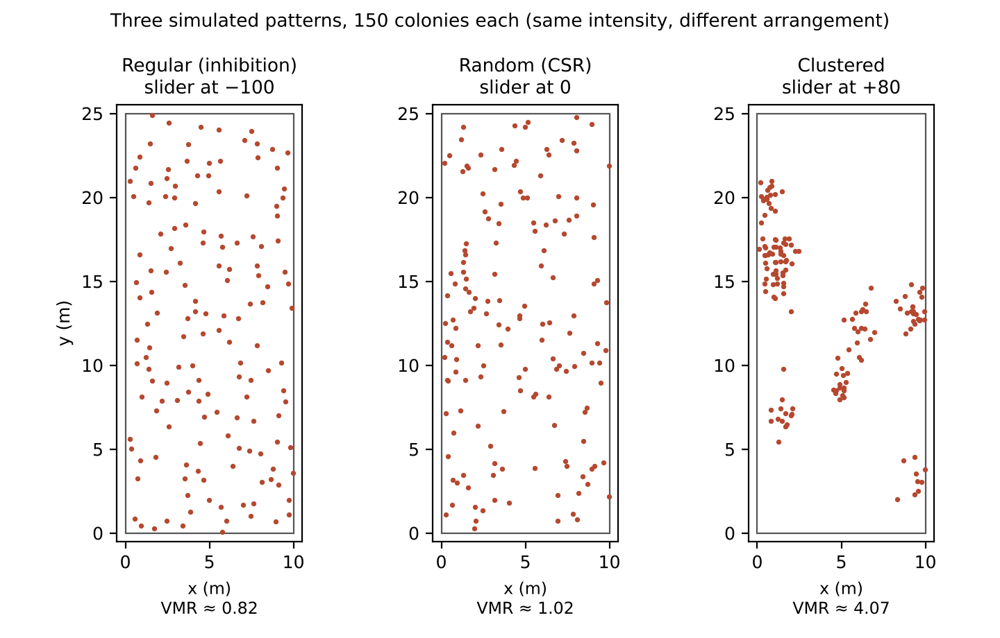
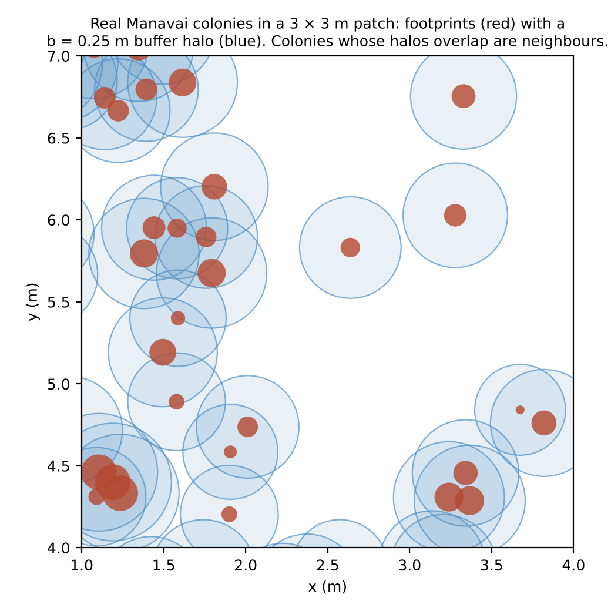

```{r setup}
#| include: false
# Everything numeric in this manual that comes from the app is computed here,
# from the app's own code and data, so the manual cannot drift from the app.
suppressPackageStartupMessages({
  library(spatstat.geom)
  library(spatstat.explore)
})
app_dir <- params$app_dir
# Load the app's constants and simulators: every top-level definition in app.R
# up to (not including) the UI. library() calls are skipped so shiny is not needed.
for (e in parse(file.path(app_dir, "app.R"), keep.source = FALSE)) {
  if (is.call(e) && identical(e[[1]], as.name("<-")) && identical(e[[2]], as.name("ui"))) break
  if (is.call(e) && identical(e[[1]], as.name("library"))) next
  eval(e, envir = globalenv())
}
sites <- data.frame(
  site     = c("Anakena", "Manavai", "Vaihu"),
  label    = c("Anakena — sheltered (north)", "Manavai — moderate (west)", "Vaihu — exposed (southeast)"),
  exposure = c("Sheltered", "Moderate", "Exposed"),
  file     = c("ana.csv", "man.csv", "vhu.csv")
)
site_ppp <- lapply(sites$file, function(f) {
  d <- read.csv(file.path(app_dir, f)); ppp(d$x, d$y, window = WIN)
})
names(site_ppp) <- sites$site
fmt <- function(x, d = 2) formatC(x, format = "f", digits = d, big.mark = ",")
# realised colony count of the Cauchy cluster simulator at a target of 300 (used in Section 4.3)
n_cluster_300 <- median(sapply(1001:1200, function(s) npoints(simulate_process("cauchy", 300, seed = s))))
```

::: {.callout-note appearance="simple" icon=false}
**App:** <https://jjherlan.github.io/rpn-spatial/> · **Source code:** <https://github.com/jjherlan/rpn-spatial> · **PDF version:** [USER_MANUAL.pdf](USER_MANUAL.pdf)

Prepared for the SCCS-NY 2026 workshop *From Photos to Spatial Pattern: Large-Area Imaging for Coral Reef Conservation*, American Museum of Natural History, 14 October 2026.
:::

This manual has two parts. **Part A** is for anyone using the app, including workshop participants; no R or programming is needed. **Part B** is for instructors and researchers who want the methods behind each tool, the statistical background with textbook references (Section 15), or who want to change the data, edit the app or redeploy it.


## 1. About the app

Each point in the app is one *Pocillopora* coral colony. The colonies were mapped from large-area imaging: thousands of overlapping underwater photos were built into a 3D model and a 2D orthoprojection of a 10 × 25 m (250 m²) reef plot, and every colony was outlined (segmented) by hand. The app takes those colony positions and asks one question:

> **Are the colonies clustered, random, or regularly spaced (over-dispersed) — and does that change along a wave-exposure gradient?**

The three real plots come from three sites on Rapa Nui (Easter Island) at about 15 m depth, surveyed in 2015. They run from sheltered to exposed. A simulation sandbox lets you build your own patterns to see what each statistic does before you apply it to real reefs.

The app runs entirely in your web browser. It is written in R with the `spatstat` packages and compiled to WebAssembly with Shinylive, so there is nothing to install, no server and no account.

### See the 3D models

Each plot was first built as a 3D model (a dense point cloud) and explored in Viscore before the 2D map was made. These short fly-throughs show the three plots in wave-exposure order; notice how the relief flattens from sheltered Anakena to exposed Vaihu.

::: {.content-visible when-format="html"}
:::: {layout-ncol=3}
::::: {}
**Anakena** — north, sheltered (surveyed 11 Sep 2015)



[Watch on YouTube ↗](https://youtu.be/dbPJ7yBsVIc){target="_blank"}
:::::
::::: {}
**Manavai** — west, moderate, plot 2 (2 Nov 2015)



[Watch on YouTube ↗](https://youtu.be/qbbIMvxGLdo){target="_blank"}
:::::
::::: {}
**Vaihu** — southeast, exposed (18 Apr 2015)



[Watch on YouTube ↗](https://youtu.be/OaPMKxSIwd8){target="_blank"}
:::::
::::
:::

::: {.content-hidden when-format="html"}
| Site | Exposure | Surveyed | Fly-through video |
|---|---|---|---|
| Anakena (north) | Sheltered | 11 Sep 2015 | [youtu.be/dbPJ7yBsVIc](https://youtu.be/dbPJ7yBsVIc) |
| Manavai (west, plot 2) | Moderate | 2 Nov 2015 | [youtu.be/qbbIMvxGLdo](https://youtu.be/qbbIMvxGLdo) |
| Vaihu (southeast) | Exposed | 18 Apr 2015 | [youtu.be/OaPMKxSIwd8](https://youtu.be/OaPMKxSIwd8) |
:::


## 2. Getting started

1. Open **https://jjherlan.github.io/rpn-spatial/** in a recent desktop browser (Chrome, Edge, Firefox or Safari). Tablets work; phones are cramped.
2. The **first load takes 20–60 seconds** while R starts inside your browser. Later visits are faster, and once loaded the app works offline.
3. The screen has two areas:
    - **Sidebar (left):** every control, grouped into *Data*, *Dispersion (quadrats)*, *Distance function + CSR envelope* and *Neighbourhood overlap*.
    - **Main panel (right):** four analysis tabs — **Point map**, **Summary**, **Distance function** and **Neighbourhood overlap** — plus a **User's manual** tab that shows this manual (or open it in its own browser tab from the link under the title).

The map and summary update as soon as you change a control. The two slower analyses (distance function and neighbourhood overlap) only run when you click their **Run** buttons.


# Part A — Using the app {.unnumbered}

## 3. Choosing your data

At the top of the sidebar, **Data** has two options.

**Real reef data** shows one of the three surveyed plots. Choose it under *Reef site (wave-exposure gradient)*:

```{r}
#| label: tbl-sites
#| tbl-cap: "The three surveyed plots (10 × 25 m each)."
knitr::kable(
  data.frame(Site = sites$label, `Wave exposure` = sites$exposure,
             Colonies = fmt(sapply(site_ppp, npoints), 0), check.names = FALSE),
  align = c("l", "l", "r"), row.names = FALSE)
```

**Simulation sandbox** replaces the real data with patterns you generate (Section 4). Real colonies are drawn in green on the map; simulated colonies in red.

## 4. The simulation sandbox

The sandbox has two tools, chosen with the radio buttons under *Simulation sandbox*. Both share the **Number of colonies** slider and the **Resample** button.

### 4.1 Number of colonies (intensity)

*Number of colonies (intensity λ = N / 250 m²)* runs from 0 to 500 (default 150). This sets how many colonies there are, which is the pattern's **intensity**, or density: λ = N ÷ 250 m². For example, 150 colonies gives λ = 0.6 colonies per m².

Intensity is a *first-order* property: it says how many, not how they are arranged. The arrangement is set separately by the tools below. Keeping the two apart is the main lesson of the sandbox.

### 4.2 Build a pattern (regular → random → clustered)

One slider, *Pattern*, runs from **−100 to +100** (default 0):

| Slider | Pattern | What the colonies do | What the statistics show |
|---|---|---|---|
| −100 to −5 | **Regular** (over-dispersed) | Repel each other; no two closer than a minimum distance | VMR < 1, Clark–Evans R > 1, g(r) < 1 at short distances |
| 0 | **Random** (complete spatial randomness, CSR) | Placed independently | VMR ≈ 1, R ≈ 1, g(r) ≈ 1 |
| +5 to +100 | **Clustered** (aggregated) | Gather around a few centres | VMR > 1, R < 1, g(r) > 1 at short distances |

The number of colonies stays fixed as you slide (at the far regular end a few may not fit), so **only the arrangement changes**.



*Figure 1. Regular, random and clustered patterns with the same 150 colonies. Drawn with a Python copy of the app's generator, so your screen will differ point by point but not in character.*

### 4.3 Pick the generating process (the paper's four models)

*Candidate process model* simulates from the four models compared in the associated manuscript:

| Model | What it represents | Typical result |
|---|---|---|
| **Complete spatial randomness (CSR / Poisson)** | The null model: every location equally likely, colonies independent | VMR ≈ 1, R ≈ 1 |
| **Habitat filtering (inhomogeneous Poisson)** | Density follows the environment. Here intensity falls about four-fold from the bottom (y = 0) to the top (y = 25 m) of the plot, but colonies don't interact | VMR slightly above 1, R ≈ 1 |
| **Biotic clustering (Cauchy cluster process)** | Offspring settle around parent colonies (about 6 per parent; half land within about 0.95 m, a few much farther) | VMR > 1, R < 1 |
| **Both — habitat + clustering (inhomogeneous Cauchy cluster)** | Clusters whose parents follow the habitat gradient | VMR > 1, R < 1, plus a density gradient |

Here *Number of colonies* sets the **expected** count. These are genuine random processes, so the actual number varies from run to run, and the cluster models usually come in below the target (about `r round(n_cluster_300)` when the target is 300, averaged over 200 runs) because the heavy-tailed Cauchy kernel scatters some offspring outside the plot, where they are dropped.

```{r}
#| label: fig-processes
#| fig-cap: "One realisation of each candidate process at 300 colonies, drawn with the app's own simulator (seed 1001, the pattern you see before clicking *Resample*). The plot is 10 m wide and 25 m long; habitat-filtering intensity is highest at the bottom (y = 0)."
#| fig-width: 9
#| fig-height: 5.4
#| out-width: "100%"
procs <- c(csr = "CSR", inhom = "Habitat filtering", cauchy = "Biotic clustering (Cauchy)", both = "Both")
op <- par(mfrow = c(1, 4), mar = c(0.5, 0.5, 3, 0.5))
for (p in names(procs)) {
  X <- simulate_process(p, 300, seed = 1001)
  plot(X, main = sprintf("%s\nn = %d", procs[[p]], npoints(X)), pch = 16, cex = 0.75,
       cols = "#b2182b", cex.main = 1.05)
}
par(op)
```

The habitat-filtering model is a useful teaching contrast: it can raise VMR above 1 without any clustering, because the quadrats pick up the density gradient. A high VMR alone does not prove that colonies attract each other.

### 4.4 Resample

**Resample** draws a fresh pattern with the same settings. Use it several times before drawing conclusions; random patterns vary, and that variation is the whole reason for the tests and envelopes.

## 5. Point map tab

Shows the current plot (10 m wide, 25 m long) with one dot per colony. The title states the site or simulation settings and the number of colonies, n.

## 6. Summary tab

The Summary tab updates instantly and reports, in order:

1. **Pattern, colonies and plot size.**
2. **Intensity** — colonies per m² (λ, first-order).
3. **Dispersion — variance-to-mean ratio (VMR).** This is the app's main statistic and the one used in the manuscript. The plot is divided into quadrats (cells) and colonies are counted in each. VMR = variance of the counts ÷ mean count.
    - **VMR > 1** = clustered, **≈ 1** = random, **< 1** = regular.
    - Below it, the **quadrat chi-square test of CSR** gives a p-value. A small p (for example below 0.05) means the counts depart from randomness.
4. **Clark–Evans index R** — a nearest-neighbour view. R = the mean distance from each colony to its nearest neighbour ÷ the distance expected under CSR. **R < 1** = clustered, **R ≈ 1** = random, **R > 1** = over-dispersed. Also shown: mean nearest-neighbour distance and a test p-value.

If there are fewer than 5 colonies, the tab asks you to add more.

**Quadrat sliders.** *Dispersion (quadrats)* sets the grid: *Quadrats across plot width (x)*, 2–12, default 10, and *Quadrats down plot length (y)*, 2–30, default 25. **Keep 10 × 25** to reproduce the manuscript's 250 one-m² cells. Changing the grid changes the scale at which you look, and VMR can change with it; that is worth exploring.

**When VMR and R disagree.** They measure different scales. R looks only at each colony's nearest neighbour (centimetres to tens of centimetres); VMR looks at 1 m² cells across the whole plot. At exposed Vaihu, for example, colonies are tightly and evenly packed locally (R > 1, over-dispersed) but patchy across the plot (VMR > 1, clustered). Both are true at their own scale.

## 7. Distance function tab

This tab looks at pattern across a **range of distances** instead of at one scale. Set the controls under *Distance function + CSR envelope*, then click **Run distance function**.

| Control | What it does |
|---|---|
| **Function** | *L-function L(r)* (a transformed Ripley's K, cumulative) or *Pair correlation g(r)* (pairs at exactly distance r) |
| **Max distance r (m)** | Largest distance plotted, 0.5–5 m (default 2.5) |
| **CSR simulations (envelope)** | How many random patterns build the grey envelope, 0–199 (default 39). More gives a smoother, slower envelope; 0 shows the curve with no envelope |
| **Subsample Vaihu to 800 colonies** | Appears only for real Vaihu (3,106 colonies). On by default to keep the envelope fast |

**How to read it.** The solid black line is your pattern. The dashed red line is the CSR expectation, and the grey band is the range of the simulated random patterns.

- **L-function:** observed *above* the band = clustering at that distance; *below* = over-dispersion; *inside* = consistent with random.
- **g(r):** g = 1 under randomness. **g > 1** = more pairs of colonies at distance r than random (clustering); **g < 1** = fewer (inhibition).

The envelope is pointwise: with 39 simulations, a curve that briefly touches the edge at one distance is weak evidence on its own. Look for sustained departures.

## 8. Neighbourhood overlap tab

The other tools treat each colony as a point. This one gives every colony its real **footprint**, a disc with the same area as the colony, and surrounds it with a **buffer halo** of width **b**, representing its zone of influence (the space it competes for, shades or interacts across). Two colonies count as **neighbours** when their haloed discs overlap. The tool asks whether neighbourhoods overlap more, or less, than they would if the same colonies were scattered at random.



*Figure 2. Real Manavai colonies in a 3 × 3 m patch, with footprints from their measured areas and a 0.25 m halo.*

**Controls** (under *Neighbourhood overlap*):

| Control | What it does |
|---|---|
| **Simulated colony sizes drawn from** | Sandbox only. Simulated colonies get sizes drawn from the measured sizes at Anakena, Manavai (default) or Vaihu. Real data always use real colony areas |
| **Buffer / border width b (m)** | Halo width, 0–1 m (default 0.25). At b = 0 only touching footprints count, which is rare because colonies are small (median diameter about 10–19 cm) |
| **Random (CSR) null simulations** | Number of random layouts to compare against, 0–199 (default 39) |
| **Run neighbourhood overlap** | Runs the analysis |

**Outputs:**

- **Map** — footprints in red and halos in blue.
- **Text summary** — median colony radius, b, the number of overlapping neighbour pairs, mean neighbours per colony, total overlap area (m²), and the share of the plot covered by halos. Then the comparison with random layouts: observed versus random mean neighbours and overlap area, each with a p-value, and a verdict based on mean neighbours:
    - *MORE overlap than random* — neighbourhoods crowd together (p ≤ 0.05);
    - *LESS overlap than random* — neighbourhoods avoid each other (p ≥ 0.95);
    - otherwise *consistent with a random layout*.
- **Histogram** — the random layouts' mean-neighbour values in grey, with your observed value as a red line. A red line far to the right of the grey bars means much more crowding than chance.

For speed, patterns with more than 1,200 colonies (real Vaihu) are analysed on a random 1,200; the summary says so. If the halo-coverage line is missing, that one calculation was skipped; everything else is unaffected.

**Ecological link.** This mirrors the buffer-based neighbourhood (co-occurrence) analysis in the associated research, where each colony is buffered and its surroundings examined. Try several values of b: the answer depends on the scale of the zone of influence you assume.

## 9. What to expect for the three reef sites

With the default 10 × 25 quadrat grid, the Summary tab should show:

```{r}
#| label: tbl-expected
#| tbl-cap: "Summary-tab values for the real reef data (10 × 25 quadrat grid), computed from the app's data files. Clark–Evans R is shown to three decimals, as the app prints it."
summ <- t(sapply(site_ppp, function(X) {
  qc <- as.numeric(quadratcount(X, nx = 10, ny = 25))
  qt <- suppressWarnings(quadrat.test(X, nx = 10, ny = 25))
  c(n = npoints(X), lam = intensity(X), vmr = var(qc) / mean(qc),
    chi = unname(qt$statistic), R = clarkevans(X)[["naive"]])
}))
knitr::kable(
  data.frame(Site = paste0(sites$site, " (", tolower(sites$exposure), ")"),
             Colonies = fmt(summ[, "n"], 0), `Intensity (per m²)` = fmt(summ[, "lam"]),
             VMR = fmt(summ[, "vmr"]), `Quadrat χ²` = fmt(summ[, "chi"], 0),
             `Clark–Evans R` = fmt(summ[, "R"], 3), check.names = FALSE),
  align = c("l", rep("r", 5)), row.names = FALSE)
```

All three sites are **clustered by VMR**, and all three depart significantly from randomness in the quadrat test. Clustering is strongest at the moderate-exposure site, Manavai, rather than rising or falling steadily with exposure. Vaihu is the case where VMR (clustered across the plot) and Clark–Evans (over-dispersed at nearest-neighbour scale) disagree. Clark–Evans p-values come from simulation, so they can vary slightly between runs.

**Neighbourhood overlap** (results vary slightly with the random layouts). In our checks at b = 0.10 m, Anakena and Manavai showed more neighbourhood overlap than random, with Manavai the strongest. Vaihu is borderline: at b = 0.10 m it looked consistent with random, and at larger buffers (around 0.30 m) some runs show more overlap than random and others do not. Treat Vaihu's overlap result as uncertain, and run it several times before drawing a conclusion. This is another example of an answer that depends on scale.

## 10. Suggested exercises

1. **Intensity is not pattern.** In *Build a pattern*, set the slider to 0 and change *Number of colonies* from 50 to 500. Watch intensity change while VMR stays near 1.
2. **The three patterns.** Hold colonies at 150 and move the slider to −100, 0 and +80. Record VMR and Clark–Evans R for each, and run the g(r) envelope at each setting.
3. **Is high VMR always clustering?** Under *Pick the generating process*, compare *Habitat filtering* with *Biotic clustering* at 300 colonies. Which raises VMR? Which lowers Clark–Evans R? What does that tell you about interpreting one statistic alone?
4. **The real gradient.** Step through Anakena, Manavai and Vaihu. Fill in the table in Section 9 yourself, then explain why Vaihu's VMR and Clark–Evans R disagree.
5. **Scale of the zone of influence.** For Manavai, run the neighbourhood overlap at b = 0.05, 0.10, 0.25 and 0.50 m. At which buffer does the verdict change, and what might that mean biologically?
6. **Chance variation.** Click *Resample* five times at the same settings and note how much VMR moves. How different would a real site need to be before you believed the difference?

## 11. Troubleshooting

| Problem | Fix |
|---|---|
| Blank page or a long spinner | First load can take up to a minute. Use a desktop browser and a stable connection |
| Old version of the app after an update | Hard-refresh with Ctrl+Shift+R (Cmd+Shift+R on Mac). The app is cached in your browser |
| Distance function or overlap is slow | Lower the number of simulations, keep the Vaihu subsample on, or reduce the colony count |
| "Need at least ~10 colonies…" | The distance function needs about 10 or more colonies; raise *Number of colonies* |
| "n is too small to analyse" | The Summary needs at least 5 colonies |
| Overlap shows no neighbours | The buffer is too small for colonies this far apart; increase b |
| Halo coverage line missing | One optional calculation was skipped; the other results stand |

## 12. Glossary

- **Complete spatial randomness (CSR):** the null model in which each colony is placed independently and every location is equally likely.
- **Intensity (λ):** expected number of colonies per unit area (first-order property).
- **First-order vs second-order:** first-order describes how many and where on average (density); second-order describes how colonies are arranged relative to each other (attraction or repulsion).
- **Variance-to-mean ratio (VMR):** variance of quadrat counts ÷ mean count; 1 under CSR.
- **Clark–Evans R:** observed mean nearest-neighbour distance ÷ expected under CSR.
- **Ripley's K and the L-function:** the cumulative number of neighbours within distance r, scaled; L(r) = r under CSR.
- **Pair correlation g(r):** relative frequency of pairs at distance exactly r; 1 under CSR.
- **Simulation envelope:** the range of a statistic across many simulated CSR patterns, used as a visual test.
- **Inhomogeneous Poisson process:** random, non-interacting colonies whose density varies over space (habitat filtering).
- **Cauchy cluster process:** parent locations scattered at random, each surrounded by a heavy-tailed cloud of offspring: most settle close to the parent, a few land far away (biotic clustering). This is the cluster model fitted in the paper and simulated by the app.
- **Buffer halo / zone of influence (b):** a band of width b around each colony's footprint representing the space it interacts across.


# Part B — For instructors and researchers {.unnumbered}

## 13. Data files

The app folder (`rpn-spatial-local/`) contains `app.R` and one CSV per site: `ana.csv` (Anakena), `man.csv` (Manavai) and `vhu.csv` (Vaihu). Each row is one size-filtered *Pocillopora* colony:

| Column | Meaning |
|---|---|
| `x` | Colony centroid across the plot width, metres (0–10) |
| `y` | Colony centroid along the plot length, metres (0–25) |
| `area_m2` | Colony planar area, m² (used only by the neighbourhood-overlap tool) |

Colony positions are the size-filtered centroids from manual segmentation of the 2D orthoprojections, as used for the dispersion analysis in the manuscript. The **areas** were attached by matching each colony to the nearest colony in the ML-segmentation size data (`*_poci_ml_sizefiltered.csv`) within 10 cm. Where no match existed, an area was drawn at random from a log-normal distribution fitted to that site's measured areas (seed 42). Match rates were 95% for Anakena, 87% for Manavai and 65% for Vaihu.

To use your own plot, supply a CSV with the same columns. If the plot is not 10 × 25 m, change `WIN` and `AREA` at the top of `app.R`, and the plot dimensions used by the generators (see Section 14).

## 14. Methods behind each tool

All statistics use `spatstat.geom` and `spatstat.explore`. The simulators use only base R plus `spatstat.geom`, so they run in the browser without `spatstat.random`.

**Summary statistics.**

- VMR from `quadratcount()` on an nx × ny grid: `var(counts) / mean(counts)`.
- Quadrat χ² test: `quadrat.test()`.
- Clark–Evans R: `clarkevans()` (naive estimate), with a two-sided `clarkevans.test()` using 99 simulations.
- Intensity: `intensity()`.

**Distance functions.** `Lest()` or `pcf()` on 200 values of r from 0 to *r max*, with a pointwise CSR `envelope()` when simulations > 0. Real Vaihu is subsampled to 800 colonies (seed 42) when the option is on.

**Build a pattern.** The slider value a ∈ [−1, 1] (slider ÷ 100):

- *a = 0* — N uniform points.
- *a < 0* (regular) — simple sequential inhibition: candidate points are placed at random and rejected if closer than d = |a| × 0.85 × (CSR mean nearest-neighbour distance, 0.5 / √λ) to an accepted point. d is kept below the packing limit, so N is normally reached.
- *a > 0* (clustered) — Matérn-style clustering with exactly N points: max(3, round(0.3 N (1 − a))) parent centres; each colony is drawn around a random parent with standard deviation 0.15 + 1.5 (1 − a) m across the plot and 2.2 times that along it, rejecting draws outside the plot.

**Pick the generating process.** Expected count N in all four models:

- *CSR:* Poisson(N) uniform points.
- *Habitat filtering:* inhomogeneous Poisson by thinning, intensity ∝ exp(1.4 (1 − y / 25)), a roughly 4:1 gradient along the plot.
- *Biotic clustering (Cauchy):* Poisson parents at intensity λ / 6; each parent has Poisson(6) offspring displaced by the isotropic bivariate Cauchy kernel with scale $\omega$ = 0.55 m, the same parametrisation as spatstat's `rCauchy` and `kppm(clusters = "Cauchy")` (each displacement is drawn as a Gaussian with standard deviation $\omega$ divided by the square root of a $\chi^2_1$ draw). The median parent–offspring distance is $\omega\sqrt{3}$ ≈ 0.95 m. Offspring outside the plot are dropped, so at N = 300 the realised count averages about 245.
- *Both:* as biotic clustering, but parents placed by the habitat-filtering process (an inhomogeneous Cauchy cluster process).

**Seeds.** Simulations are seeded from the Resample counter, so the same settings and the same number of clicks reproduce the same pattern within a session.

**Neighbourhood overlap.**

- Each colony's equivalent radius is r = √(area / π); its halo radius is R = r + b.
- Pairs of colonies are found with `closepairs()` up to 2 max(R). A pair are neighbours if their centre distance is less than Rᵢ + Rⱼ.
- Overlap area is the exact circle–circle (lens) intersection area. Mean neighbours per colony = 2 × pairs ÷ n.
- Halo coverage is the area of the union of halos, from `discs()` rasterised at 0.1 m.
- **Null model:** the same set of radii is placed at random (CSR) positions *nsim* times. The one-sided Monte Carlo p-value is (1 + number of null values ≥ observed) ÷ (nsim + 1).
- Simulated colonies' sizes are log-normal draws using per-site parameters (meanlog, sdlog) of (−5.116, 0.759) for Anakena, (−4.627, 0.946) for Manavai and (−3.723, 0.970) for Vaihu, fitted to the ML size data.
- Patterns larger than 1,200 colonies are subsampled to 1,200 (seed 7).

The implementation was validated against an independent Python implementation of the same algorithms (VMR and Clark–Evans trends across the pattern slider, the four process models, and lens-area overlap and null tests on the real data).

## 15. Statistical background

This section explains the mathematics behind the dispersion analysis in the paper and in the app. Each subsection gives the key equations, what they mean for the Rapa Nui plots, and where to read more in three standard textbooks:

- **Illian et al. (2008)** — Illian, Penttinen, Stoyan & Stoyan, *Statistical Analysis and Modelling of Spatial Point Patterns*. The most mathematical of the three; gives estimators and their properties.
- **Baddeley et al. (2016)** — Baddeley, Rubak & Turner, *Spatial Point Patterns: Methodology and Applications with R*. The `spatstat` book; links each formula to the R function that runs it.
- **Wiegand & Moloney (2014)** — *Handbook of Spatial Point-Pattern Analysis in Ecology*. Written for ecologists; best for interpretation and choosing null models.

Page numbers are the printed page numbers of each book. Table 15.1 at the end collects them.

**Notation.** $X$ is the point process (the unknown rule that places colonies). $x_1, \dots, x_n$ are the $n$ colony centroids in one plot. $W$ is the observation window, a 25 × 10 m plot with area $|W| = 250$ m². $N(B)$ is the number of colonies in a region $B$. $d_{ij}$ is the distance between colonies $i$ and $j$, and $r$ is a distance.

### 15.1 Point processes and complete spatial randomness

A map of colonies is treated as one *realisation* of a random point process, seen through the window $W$. The benchmark is the homogeneous Poisson process with intensity $\lambda$, or *complete spatial randomness* (CSR). It has two defining properties:

$$
P\lbrace N(B) = k \rbrace = e^{-\lambda |B|}\,\frac{(\lambda |B|)^k}{k!}, \qquad k = 0, 1, 2, \dots
$$

and counts in non-overlapping regions are independent. Given $n$ points in $W$, CSR places each one independently and uniformly in $W$ (a *binomial process*).

A process is **stationary** if shifting it does not change its statistical properties, and **isotropic** if rotating it does not. Together with ergodicity, these assumptions let us estimate second-order functions (Section 15.4) from a single plot by averaging over all colonies, instead of needing many replicate reefs.

At Rapa Nui, after the 9 cm² size filter, $n$ = 124 (Anakena), 368 (Manavai) and 3,106 (Vaihu). CSR is a reference, not an ecological hypothesis: it is what the reef would look like if location carried no information.

*Read more:* Illian et al. 2008 §1.6.3 (p. 37), §2.2–2.3 (pp. 59–70); Baddeley et al. 2016 §5.3 (pp. 132–138); Wiegand & Moloney 2014 §2.4.1 (p. 67).

### 15.2 Intensity: constant or varying in space

For a stationary process, the intensity (expected colonies per m²) is estimated without bias by

$$
\hat\lambda = \frac{n}{|W|},
$$

giving 0.50, 1.47 and 12.42 colonies m⁻² for Anakena, Manavai and Vaihu.

When intensity varies across the plot, $\lambda(u)$ is estimated by **kernel smoothing**. Each colony contributes a Gaussian bump $\kappa_\sigma$ with standard deviation (bandwidth) $\sigma$, and an edge-correction factor $e_\sigma(u)$ compensates for colonies just outside the plot that we cannot see:

$$
\hat\lambda_\sigma(u) = \frac{1}{e_\sigma(u)} \sum_{i=1}^{n} \kappa_\sigma(u - x_i), \qquad e_\sigma(u) = \int_W \kappa_\sigma(u - v)\, dv .
$$

The bandwidth trades bias against variance. The paper chose it by **likelihood cross-validation** (`bw.ppl`), maximising

$$
\mathrm{LCV}(\sigma) = \sum_{i=1}^{n} \log \hat\lambda_\sigma^{(-i)}(x_i) - \int_W \hat\lambda_\sigma(u)\, du ,
$$

where $\hat\lambda_\sigma^{(-i)}$ is the estimate computed without colony $i$. The selected bandwidths were σ = 0.93 m (Anakena), 0.52 m (Manavai) and 2.14 m (Vaihu). The resulting surface $\hat\lambda(u)$ is the "habitat" term of the inhomogeneous models (Section 15.7).

*Read more:* Illian et al. 2008 §2.6 (p. 79), §3.3.2 (p. 114); Baddeley et al. 2016 §6.2 (p. 159), §6.5.1 eqs 6.7–6.10 (p. 168), `bw.ppl` (p. 171); Wiegand & Moloney 2014 §2.6.2.1 (p. 94).

### 15.3 Single-number tests: VMR, χ² and Clark–Evans

**Index of dispersion (VMR).** Divide the plot into $Q$ = 250 cells of 1 m² and count colonies $n_q$ in each:

$$
\mathrm{VMR} = \frac{s^2}{\bar n}, \qquad s^2 = \frac{1}{Q-1} \sum_{q=1}^{Q} (n_q - \bar n)^2 .
$$

Under CSR the counts are Poisson, whose variance equals its mean, so VMR ≈ 1; VMR > 1 indicates clustering and VMR < 1 regularity. The paper bootstrapped VMR by resampling cells with replacement (B = 1000) to obtain a 95% percentile interval.

**Chi-square test.** The index-of-dispersion test statistic is the same as Pearson's chi-square statistic used by `quadrat.test()`:

$$
X^2 = \sum_{q=1}^{Q} \frac{(n_q - \bar n)^2}{\bar n} = (Q-1)\,\mathrm{VMR} \;\sim\; \chi^2_{Q-1} \ \text{under CSR}.
$$

**Clark–Evans index.** The mean nearest-neighbour distance divided by its CSR value $1/(2\sqrt{\lambda})$:

$$
R = 2\sqrt{\lambda}\;\bar d_{\mathrm{NN}} .
$$

R < 1 indicates clustering and R > 1 regularity (the maximum, 2.15, is a hexagonal lattice).

| Site | VMR (bootstrap mean, 95% CI) | X² (df = 249) | p | Clark–Evans R* |
|---|---|---|---|---|
| Anakena | 1.51 (1.19–1.90) | 380.0 | 3 × 10⁻⁷ | 0.80 |
| Manavai | 5.55 (3.99–7.44) | 1396.9 | < 10⁻¹⁵⁰ | 0.60 |
| Vaihu | 1.23 (1.02–1.46) | 308.2 | 0.013 | 1.26 |

\* Clark–Evans R is computed by the app; it is not reported in the paper. The X² values equal 249 × the direct (non-bootstrap) VMRs of 1.53, 5.61 and 1.24.

All three are **single-scale** summaries. VMR depends on the cell size, and Clark–Evans looks only at the nearest neighbour. At Vaihu, VMR > 1 but R > 1: colonies have area and cannot overlap, so nearest neighbours are spaced out, while counts are patchy at the metre scale. Baddeley et al. also note that R is very sensitive to spatial inhomogeneity.

*Read more:* Illian et al. 2008 §2.7.2 eq. 2.7.3 (p. 87), §2.7.5 (p. 92), §4.2.4 eqs 4.2.22 and 4.2.24 (pp. 195–196); Baddeley et al. 2016 p. 12, §6.4.2 (pp. 164–166), p. 201, §8.2.2 (p. 258).

### 15.4 Second-order structure: K, L and g

Second-order functions describe how colonies are arranged *relative to each other* at each distance $r$.

- **Ripley's K-function.** $\lambda K(r)$ is the expected number of other colonies within distance $r$ of a typical colony. Under CSR, $K(r) = \pi r^2$.
- **L-function.** $L(r) = \sqrt{K(r)/\pi}$ stabilises the variance and makes the CSR benchmark the straight line $L(r) = r$.
- **Pair correlation function.** $g(r) = K'(r) / (2\pi r)$. Equivalently $g(r) = \rho^{(2)}(r)/\lambda^2$, the density of pairs at distance $r$ divided by its CSR value. K is cumulative (a disc); g uses only pairs at distance $r$ (a ring), so it shows the *scale* of structure.

Reading g: g(r) = 1 means pairs at distance r are as common as under randomness; g(r) > 1 means clustering at that scale; g(r) < 1 means inhibition.

For patterns with varying intensity, the **inhomogeneous** versions weight each pair by the local intensities:

$$
g_{\mathrm{inhom}}(r) = \frac{\rho^{(2)}(u, v)}{\lambda(u)\,\lambda(v)}, \qquad \lVert u - v \rVert = r .
$$

Every Poisson process, homogeneous or not, has g = 1 on the appropriate scale. So g isolates *interaction* from *intensity*, provided $\lambda(u)$ is estimated well. This requires second-order intensity-reweighted stationarity: after removing the intensity, interaction is the same everywhere.

*Read more:* Illian et al. 2008 §4.3.1–4.3.2 (pp. 214–228), §4.10.2 (p. 281); Baddeley et al. 2016 §7.3 (p. 203), §7.6 eq. 7.22 (p. 225), §7.10.2 eqs 7.48–7.50 (p. 243); Wiegand & Moloney 2014 §2.3.2 (pp. 43–52), §2.6.3.5 (p. 129).

### 15.5 Estimating g from one plot: edge correction and smoothing

Colonies near the edge have neighbours outside the plot that we cannot see, so uncorrected estimates are biased downward at larger $r$. The estimators sum over pairs with an edge-correction weight $e_{ij}$:

$$
\hat K(r) = \frac{|W|}{n(n-1)} \sum_{i} \sum_{j \neq i} \mathbf{1}\lbrace d_{ij} \le r \rbrace\, e_{ij} .
$$

The **translation correction** used in the paper's envelopes is

$$
e_{ij} = \frac{|W|}{|W \cap (W + x_j - x_i)|} ,
$$

a Horvitz–Thompson weight: pairs whose separation is rarely observable in a 10 m-wide plot get larger weights. Ripley's isotropic correction instead uses the fraction of the circle through $x_j$, centred at $x_i$, that lies inside $W$.

The **kernel estimator** of g replaces the indicator by a smoothing kernel $\kappa_h$:

$$
\hat g(r) = \frac{|W|}{2\pi r\, n(n-1)} \sum_{i} \sum_{j \neq i} \kappa_h(r - d_{ij})\, e_{ij},
\qquad
\hat g_{\mathrm{inhom}}(r) = \frac{1}{2\pi r\, |W|} \sum_{i} \sum_{j \neq i} \frac{\kappa_h(r - d_{ij})\, e_{ij}}{\hat\lambda(x_i)\, \hat\lambda(x_j)} .
$$

`spatstat` uses the Epanechnikov kernel with standard deviation (bandwidth) $h$ and half-width $w = \sqrt{5}\,h$:

$$
\kappa_h(x) = \frac{3}{4w}\left(1 - \frac{x^2}{w^2}\right)_{+} .
$$

The paper reports a 5 mm bandwidth, following Edwards et al. (2017). If no bandwidth is supplied, `pcf()` uses Stoyan's rule of thumb, $h = 0.15/\sqrt{5\hat\lambda}$ (about 0.095, 0.055 and 0.019 m at the three sites). Estimates of g at very small r are unreliable because few pairs are that close, so the analysis evaluates g from about one colony width (0.12, 0.14 and 0.17 m at Anakena, Manavai and Vaihu) to 2.5 m.

*Read more:* Illian et al. 2008 §4.2.2 (p. 180), §4.3.3 eqs 4.3.27–4.3.31 (pp. 228–236); Baddeley et al. 2016 §7.4 (pp. 212–219), §7.6.2 eqs 7.26–7.29 (pp. 228–229); Wiegand & Moloney 2014 §3.1.1 (p. 144), §3.1.2.4 (p. 159).

### 15.6 Cluster processes: Neyman–Scott and Cauchy

A **Neyman–Scott** cluster process is built in three steps:

1. Unobserved *parents* form a Poisson process with intensity $\kappa$.
2. Each parent produces a Poisson($\mu$) number of *offspring*.
3. Offspring are displaced from their parent independently, with density $h(u)$. Only offspring are mapped.

Then

$$
\lambda = \kappa\mu, \qquad g(r) = 1 + \frac{h_2(r)}{\kappa},
$$

where $h_2$ is the density of the vector between two offspring of the same parent.

In the **Cauchy cluster process** used in the paper (and simulated by the app, with $\omega$ = 0.55 m), offspring follow a bivariate Cauchy density with scale $\omega$:

$$
h(u) = \frac{1}{2\pi\omega^2}\left(1 + \frac{\lVert u \rVert^2}{\omega^2}\right)^{-3/2}.
$$

The difference of two such displacements is again Cauchy, with scale $2\omega$, which gives

$$
g_{\kappa,\omega}(r) = 1 + \frac{1}{8\pi\kappa\omega^2}\left(1 + \frac{r^2}{4\omega^2}\right)^{-3/2},
\qquad
K_{\kappa,\omega}(r) = \pi r^2 + \frac{1}{\kappa}\left[1 - \left(1 + \frac{r^2}{4\omega^2}\right)^{-1/2}\right].
$$

The Cauchy kernel is heavy-tailed, so g decays like $r^{-3}$ and a few offspring land far from their parent. Compare the **Thomas** process (Gaussian scatter with standard deviation $\sigma$), the other common Neyman–Scott model, whose clusters are tighter and better separated:

$$
g_{\kappa,\sigma}(r) = 1 + \frac{1}{4\pi\kappa\sigma^2}\exp\left(-\frac{r^2}{4\sigma^2}\right).
$$

Interpretation: $\kappa$ is the density of cluster centres, $\omega$ (or $\sigma$) the cluster spread, and $\lambda/\kappa$ the mean number of colonies per cluster. Small $\kappa\omega^2$ means few, compact clusters: strong clustering. For *Pocillopora*, parents can stand for recruitment hotspots, fragmentation sources or patches of suitable substrate (Edwards et al. 2017).

The **inhomogeneous** cluster model (model 4) uses the kernel surface as a log-linear offset, so that $\lambda(u) = e^{\beta_0}\,\hat\lambda(u)$ while $\kappa$ and $\omega$ govern $g_{\mathrm{inhom}}$.

*Read more:* Illian et al. 2008 §6.3.2 eqs 6.3.1–6.3.2 (pp. 374–379); Baddeley et al. 2016 §12.3 (p. 459), eq. 12.12 (p. 463), eqs 12.24–12.25 (p. 482); Wiegand & Moloney 2014 §4.1.4 (pp. 317–329).

### 15.7 Fitting the four models

| Model | Hypothesis | Intensity | Interaction | Fitted with |
|---|---|---|---|---|
| 1. Homogeneous Poisson | CSR | constant λ | none | `ppm(X ~ 1)` |
| 2. Inhomogeneous Poisson | Habitat filtering | $e^{\beta_0}\hat\lambda(u)$ | none | `ppm(X ~ offset(log(lambda)))` |
| 3. Homogeneous Cauchy cluster | Biotic aggregation | constant λ | Cauchy clusters | `kppm(X ~ 1, clusters = "Cauchy", statistic = "pcf")` |
| 4. Inhomogeneous Cauchy cluster | Both | $e^{\beta_0}\hat\lambda(u)$ | Cauchy clusters | `kppm(X ~ offset(log(lambda)), clusters = "Cauchy", statistic = "pcf")` |

**Poisson models** are fitted by maximum likelihood. The log-likelihood of a Poisson process with intensity $\lambda_\theta(u)$ is

$$
\log L(\theta) = \sum_{i=1}^{n} \log \lambda_\theta(x_i) - \int_W \lambda_\theta(u)\, du .
$$

For model 2, only $\beta_0$ is estimated; it rescales the kernel surface so that the expected count equals $n$.

**Cluster models** have no tractable likelihood. They are fitted by **minimum contrast**, a curve-fitting form of the method of moments:

$$
\hat\theta = \arg\min_{\theta} \int_{r_0}^{r_{\max}} \left[\hat g(r)^{q} - g_\theta(r)^{q}\right]^2 dr ,
$$

choosing $\theta = (\kappa, \omega)$ so that the model's $g_\theta$ (Section 15.6) matches the estimate $\hat g$. The analysis used $r_{\max}$ = 2.5 m. Illian et al. recommend fitting to g rather than K, to avoid the correlated residuals of a cumulative function, with $r_0 > 0$ because $\hat g$ is unreliable at small $r$. Wiegand & Moloney advise that $r_{\max}$ should not be much larger than the range of the biological effect, and discuss the power $q$. Palm likelihood and composite likelihood (`kppm(..., method = "palm")` or `"clik2"`) are alternatives worth comparing.

*Read more:* Illian et al. 2008 §7.2.1–7.2.2 eq. 7.2.1 (pp. 448–452); Baddeley et al. 2016 §9.7 eqs 9.39–9.40 (pp. 341–343), §12.4.2 (pp. 470–475); Wiegand & Moloney 2014 §2.5.2.1 eq. 2.11 (pp. 79–81).

### 15.8 Monte Carlo goodness of fit: the DCLF test

There is no closed-form sampling distribution for $\hat g$ under a fitted model, so fit is assessed by simulation:

1. Simulate $D$ patterns from the fitted model in the same window ($D$ = 200 in the paper).
2. Estimate $\hat g_1, \dots, \hat g_D$ in exactly the same way as the observed $\hat g_0$, so estimation bias affects all curves equally.
3. Compute a reference curve and, for every curve, the integrated squared deviation from it:

$$
\bar g(r) = \frac{1}{D+1} \sum_{i=0}^{D} \hat g_i(r), \qquad
T_i = \int_{r_0}^{r_{\max}} \left[\hat g_i(r) - \bar g(r)\right]^2 dr, \quad i = 0, 1, \dots, D .
$$

4. The p-value is the rank of the observed statistic:

$$
p = \frac{1 + \#\lbrace i \ge 1 : T_i \ge T_0 \rbrace}{D + 1}, \qquad p_{\min} = \frac{1}{D+1} .
$$

This is the Diggle–Cressie–Loosmore–Ford (DCLF) test (`dclf.test()`). If the model is true, $T_0$ is exchangeable with $T_1, \dots, T_D$, so its rank is uniformly distributed and the test has exact size without any distribution theory. With $D$ = 200, the smallest attainable p is 1/201 ≈ 0.005 — the value reported for CSR at Anakena and Manavai.

Two points matter when reading results:

- **Pointwise envelopes are not a test of the whole curve.** A pointwise envelope from $D$ simulations is an exact test only at one distance chosen in advance. Declaring significance wherever the curve leaves the band, over many $r$, inflates the error rate. The DCLF test (or a global envelope) uses one number for the whole range.
- **Estimated parameters make the test conservative.** The model was fitted to the same data it is tested against, so the true error rate is somewhat below the nominal level, especially when the same function (g) is used to fit and to test. Illian et al. suggest testing with a different summary, e.g. L(r) or the nearest-neighbour distance distribution.

*Read more:* Illian et al. 2008 §7.4.1–7.4.2 eq. 7.4.2 (pp. 455–458); Baddeley et al. 2016 §10.6 (pp. 384–389), §10.7.1–10.7.4 eqs 10.21–10.22 (pp. 391–395); Wiegand & Moloney 2014 §2.5.1 (pp. 74–78).

### 15.9 Interpreting the results

- **Clustering and habitat can be confounded.** A single realisation of a stationary cluster process can be indistinguishable from an inhomogeneous Poisson process (Bartlett 1964). This is the statistical reason that three models fit at Anakena and Manavai, and why the paper used neighbourhood composition to discriminate between them (Baddeley et al. 2016 §5.7.4, p. 151).
- **"Not rejected" is not "true".** A large p means the model is consistent with the data at this sample size. Power grows with $n$: 124 colonies at Anakena versus 3,106 at Vaihu.
- **Every statistic has a scale.** VMR sees 1 m² cells, Clark–Evans the nearest neighbour, and g the range from about 0.12 to 2.5 m. Agreement across scales is evidence; disagreement, as at Vaihu, is information (Wiegand & Moloney 2014 §2.6.2, pp. 92–105).
- **Colonies are not points.** Centroids of objects with area cannot be closer than about one colony radius, so g < 1 at very short range is expected rather than evidence of competition (Wiegand & Moloney 2014 §2.2.4, p. 38; §3.1.8, pp. 235–241).
- **When every model fails.** At Vaihu all four models are rejected. The generating process is probably scale-dependent, for example heterogeneity at large scales and clustering at small scales, or a superposition of processes; none of the four candidates represents that (Wiegand & Moloney 2014 §3.3, p. 263; §4.1.2.2, p. 309).

### 15.10 Where to read more

**Table 15.1.** Textbook sections for each method (printed page numbers).

| Topic | Illian et al. (2008) | Baddeley et al. (2016) | Wiegand & Moloney (2014) |
|---|---|---|---|
| Point processes, stationarity | §1.5–1.6, pp. 23–40 | Ch. 5, pp. 127–152 | §2.1, pp. 11–26 |
| CSR / Poisson process | §2.3, pp. 66–70 | §5.3, pp. 132–138 | §2.4.1, p. 67 |
| Intensity and kernel estimation | §2.6, p. 79; §3.3.2, p. 114 | §6.2, p. 159; §6.5.1, pp. 168–171 | §2.6.2.1, p. 94 |
| Quadrat counts, index of dispersion | §2.7.2, p. 86; §4.2.4, p. 195 | §6.4, pp. 163–166; p. 201 | §2.6.2, p. 92 |
| Clark–Evans index | §2.7.5, p. 92; eq. 4.2.24, p. 196 | §8.2.2, p. 258 | §2.3.4, p. 58 |
| K, L and g | §4.3.1, pp. 214–223 | §7.3, p. 203; §7.6, p. 225 | §2.3.2, pp. 43–52 |
| Edge correction, estimators | §4.2.2, p. 180; §4.3.3, pp. 228–239 | §7.4, pp. 212–219; §7.6.2, p. 228 | §3.1, pp. 142–172 |
| Inhomogeneous K and g | §4.10.2, p. 281 | §7.10.2, p. 243 | §2.6.3.5, p. 129 |
| Neyman–Scott, Cauchy and Thomas | §6.3.2, pp. 374–379 | §12.3, pp. 459–468; p. 482 | §4.1.4, pp. 317–329 |
| Maximum likelihood (Poisson) | §7.2.1, p. 448 | §9.7, pp. 341–343 | §2.5.2.2, p. 83 |
| Minimum contrast | §7.2.2, pp. 450–452 | §12.4.2, p. 470 | §2.5.2.1, pp. 79–81 |
| Envelopes and DCLF test | §7.4, pp. 455–458 | §10.6–10.7, pp. 384–396 | §2.5.1, pp. 74–78 |
| Clustering vs. inhomogeneity | — | §5.7.4, p. 151 | §2.6, pp. 85–92 |

## 16. Running the app in R

```r
install.packages(c("shiny", "spatstat.geom", "spatstat.explore"))
shiny::runApp("rpn-spatial-local")
```

In RStudio you can also open `rpn-spatial-local/app.R` and click **Run App**. Running in desktop R is faster for large envelopes and lets you add packages that are not available in the browser version.

## 17. Updating and redeploying

The public site is the exported Shinylive bundle in the repository root (`index.html`, `app.json`, `shinylive/`, `shinylive-sw.js`, `.nojekyll`), served by GitHub Pages from the `main` branch.

**Step 1.** Edit `rpn-spatial-local/app.R` or the CSVs.

**Step 2.** Re-export from the folder that contains both `rpn-spatial-local/` and the repository folder (`site/`):

```r
setwd("C:/Users/boros/Large Area Imaging")
shinylive::export("rpn-spatial-local", "site")
```

**Step 3.** Test locally:

```r
httpuv::runStaticServer("site")
```

**Step 4.** Commit and push (Git Bash):

```bash
cd "/c/Users/boros/Large Area Imaging/site"
git add -A
git commit -m "Describe the change"
git push
```

**Step 5.** After a minute or two, hard-refresh the live app (Ctrl+Shift+R).

**Updating this manual.** The manual is written in Quarto: `manual-src/USER_MANUAL.qmd` in the repository (figures in `manual-src/manual/`, styling in `manual.scss`). Its tables of site values and its simulation figure are computed from `rpn-spatial-local/app.R` and the CSVs when it renders, so they always match the app. To rebuild after editing (needs [Quarto](https://quarto.org) and the R packages `knitr`, `rmarkdown`, `spatstat.geom` and `spatstat.explore`):

```bash
cd manual-src
quarto render USER_MANUAL.qmd -P app_dir:../rpn-spatial-local
cp manual.html USER_MANUAL.pdf ..
```

Then commit and push. The app's *User's manual* tab loads the live `manual.html`, so manual-only changes do not need a Shinylive re-export.

Packages used by the app must be available in the WebR package repository. Packages with heavy compiled dependencies (for example `sf`, `terra`, `spEDM`, `rEDM`) do not work in the browser version.

## 18. Known limitations

- Colonies are treated as points (all tools except neighbourhood overlap) or as discs with the colony's area (overlap). Real colony shapes are not used.
- About 5–35% of colony areas, depending on site, were drawn from each site's size distribution rather than matched to a measured colony (Section 13).
- Envelopes are pointwise and based on modest simulation counts; they are visual guides, not formal global tests.
- The process models use illustrative parameters (cluster size, spread, habitat gradient), not values fitted to the Rapa Nui data.
- Neighbourhood overlap uses a CSR null that ignores edge effects and any habitat gradient; a significant result means "more crowded than random", not a specific mechanism.
- Very large patterns are subsampled for speed (800 colonies for Vaihu envelopes, 1,200 for overlap).

## 19. Citation and references

If you use the app or its data, please cite:

- **Data:** Herlan, J. et al. Rapa Nui coral spatial ecology. Dryad. https://doi.org/10.5061/dryad.s1rn8pkp4
- **Associated manuscript:** Herlan, J. et al. (2026). *Marine Ecology Progress Series* (final volume and pages to be added).
- **App:** Herlan, J. (2026). Rapa Nui Coral Spatial Pattern (Shinylive app). https://github.com/jjherlan/rpn-spatial

Methods references:

- Baddeley, A., Rubak, E. & Turner, R. (2016). *Spatial Point Patterns: Methodology and Applications with R.* Chapman & Hall/CRC.
- Bartlett, M.S. (1964). A note on spatial pattern. *Biometrics* 20: 891–892.
- Edwards, C.B., Eynaud, Y., Williams, G.J., Pedersen, N.E., Zgliczynski, B.J., Gleason, A.C.R., Smith, J.E. & Sandin, S.A. (2017). Large-area imaging reveals biologically driven non-random spatial patterns of corals at a remote reef. *Coral Reefs* 36: 1291–1305.
- Illian, J., Penttinen, A., Stoyan, H. & Stoyan, D. (2008). *Statistical Analysis and Modelling of Spatial Point Patterns.* Wiley, Chichester.
- Loosmore, N.B. & Ford, E.D. (2006). Statistical inference using the G or K point pattern spatial statistics. *Ecology* 87: 1925–1931.
- Wiegand, T. & Moloney, K.A. (2014). *Handbook of Spatial Point-Pattern Analysis in Ecology.* Chapman & Hall/CRC, Boca Raton.
- Clark, P.J. & Evans, F.C. (1954). Distance to nearest neighbor as a measure of spatial relationships in populations. *Ecology* 35: 445–453.
- Chiu, S.N., Stoyan, D., Kendall, W.S. & Mecke, J. (2013). *Stochastic Geometry and Its Applications*, 3rd ed. Wiley.

Built with R, Shiny, spatstat, Shinylive and WebR.
